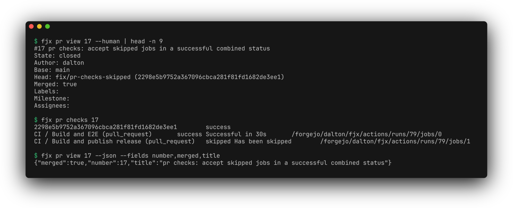

# fjx

`fjx` is a small Forgejo command-line client for people and scripts. It is one
synchronous binary with stable output, private token storage, and HTTP requests
that never follow redirects.

- Manage issues, pull requests, reviews, checks and merges.
- Watch action runs, dispatch workflows, and publish releases and assets.
- Manage labels, milestones, branches, webhooks, organizations and teams.
- Move issue cards on Gitea project boards.
- Read output as tab-separated text, readable views, or JSON with chosen fields.
- Preview every write with `--dry-run`. Use `fjx api` for any other endpoint.
- Serve read-only tools to local AI agents over MCP (`fjx mcp serve`).

fjx is tested against Forgejo 15.0.7 and 17.0 API data. Board commands need
Gitea (checked with 28.2.0).

## Preview

Real output from this repository's Forgejo server:



## Install (recommended)

Download the archive for your system and its `.sha256` file from
[Forgejo Releases](https://dyad.tail77425.ts.net/forgejo/dalton/fjx/releases)
or the [GitHub mirror](https://github.com/DaltonAlley/fjx/releases).

| System | Archive target |
| --- | --- |
| Linux x86-64 or ARM64, glibc | `x86_64-unknown-linux-gnu` or `aarch64-unknown-linux-gnu` |
| Linux x86-64 or ARM64, musl (static) | `x86_64-unknown-linux-musl` or `aarch64-unknown-linux-musl` |
| macOS Apple Silicon | `aarch64-apple-darwin` |
| Windows x86-64 | `x86_64-pc-windows-gnu` (`.zip`) |

Check the archive, then extract it. For example, on Linux x86-64 with glibc:

```sh
sha256sum --check fjx-0.6.0-x86_64-unknown-linux-gnu.tar.gz.sha256
tar -xzf fjx-0.6.0-x86_64-unknown-linux-gnu.tar.gz
./fjx --version
```

Move `fjx` to a directory on `PATH`. On macOS, check with `shasum -a 256 -c`.
On Windows, compare `Get-FileHash -Algorithm SHA256` with the `.sha256` file,
then put `fjx.exe` on `PATH`.

## Build from source

Install Git and Rust 1.97.1 (pinned in [rust-toolchain.toml](rust-toolchain.toml)).

```sh
git clone https://dyad.tail77425.ts.net/forgejo/dalton/fjx.git
cd fjx
cargo install --path . --locked
fjx --version
```

Cargo installs to `$HOME/.cargo/bin`; make sure it is on `PATH`. To build
without installing, run `cargo build --locked --release` and use
`target/release/fjx`. fjx is not published to crates.io.

## Quick start

```sh
fjx auth login --host https://forgejo.example
fjx repo view -R owner/repo
fjx issue list -R owner/repo --all --json --fields number,title,state
fjx pr checks -R owner/repo 12
fjx issue create -R owner/repo --title "Bug" --body-file report.md --dry-run
```

`auth login` opens the browser for OAuth. No app registration is needed on a
standard Forgejo or Gitea server. For a token instead, use
`fjx auth login --with-token`, or set `FJX_TOKEN` or `FORGEJO_TOKEN`.
Inside a clone, fjx reads the host and repository from the Git or jj remote, so
`--host` and `-R` are optional. `fjx auth setup-git` lets Git and `jj` use the
same login.

Run `fjx help`, `fjx help COMMAND`, or `fjx COMMAND ACTION --help` for flags and
examples. Help works offline.

## Documentation

- [CLI workflows and reference](docs/cli-workflows.md): login, commands, safety
  rules, output contracts, organizations, webhooks, boards and MCP
- [Architecture](docs/architecture.md)
- [Release maintenance](docs/releasing.md) and [repository maintenance](docs/repository-maintenance.md)
- [Benchmarks](docs/benchmarks.md)
- [MIT license](LICENSE)

## Development and releases

Use Rust 1.97.1 and [just](https://github.com/casey/just). Tests also need Git,
Bash and `script` (util-linux). They run against local fixtures and need no
Forgejo account.

```sh
just check        # build and tests (GitHub CI gate)
just check-full   # also fmt, Clippy, docs, release tools (Forgejo CI gate)
just              # list all commands
```

`just check-full` also needs Python 3.11 or newer, Nushell 0.112.2 (for one
repository test), GNU coreutils, `tar`, `gzip`, `zip`, `unzip` and `file`. On Linux with Nix,
[shell.nix](shell.nix) provides all tools: `nix-shell --run 'just check-full'`.

A version increase merged to `main` makes Forgejo CI build, check and publish
a release for all six targets. A separate workflow copies it to GitHub. See
[release maintenance](docs/releasing.md).
